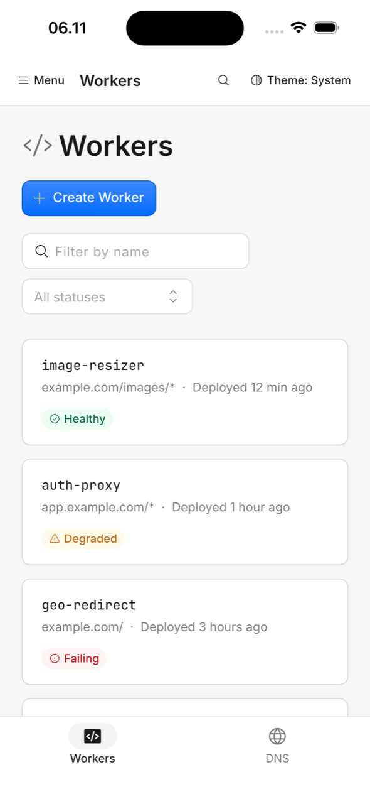
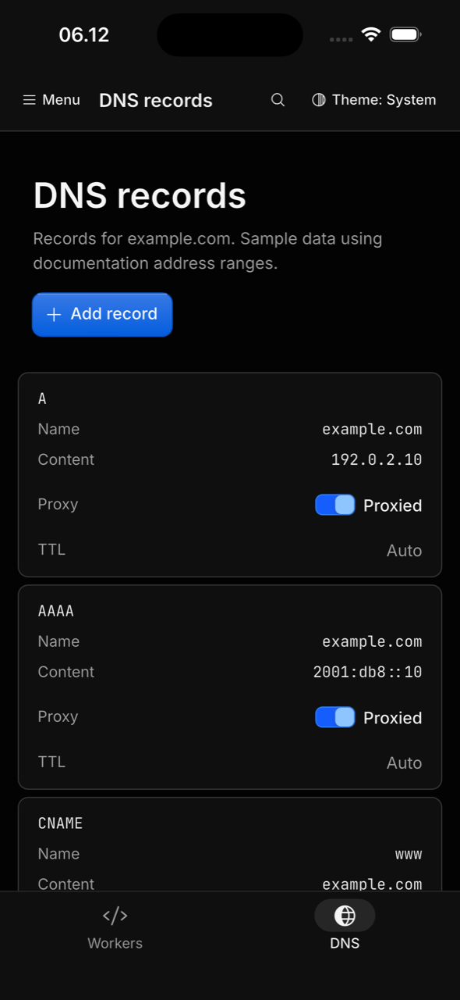
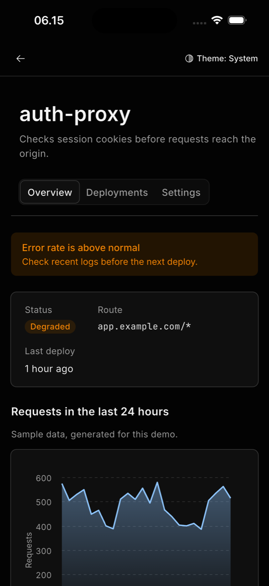

# kumo_flutter

[](https://pub.dev/packages/kumo_flutter)
[](https://github.com/mralifakbar/kumo_flutter/actions/workflows/ci.yml)
[](LICENSE)
[](https://flutter.dev)

An unofficial Flutter port of [Kumo](https://kumo-ui.com), Cloudflare's design system. It brings Kumo's tokens, light and dark themes, 1,530 Phosphor icons and 100 documented components to Flutter, adapted so the same dense dashboard language also works on phones.

> **Not affiliated with Cloudflare.** This is an independent, community-maintained port of the open-source Kumo library (MIT). "Cloudflare" and "Kumo" are used only to say what this package is a port of. The Cloudflare logo is not included.

<p>
  
  
  
</p>

## Why

Kumo ships for React. This package brings the same tokens, components and behavior to Flutter, so a Flutter app on iOS, Android, web or desktop can look and behave like a Kumo product.

- **Faithful to Kumo.** The 54 semantic colors are generated from Kumo's OKLCH theme CSS with the gamut mapping browsers use, and checked against Tailwind's published values. Spacing, radii, rings, type scale and component variants follow Kumo's Tailwind classes; prop names follow Kumo (`variant`, `size`, `open`/`onOpenChange`, `value`/`onValueChange`), so Kumo docs translate directly.
- **Desktop-dense, phone-ready.** Visuals keep Kumo's 36px controls; on touch screens every hit area grows to 44px. Below 768px, menus, selects and pickers open as bottom sheets, dialogs fill the width, the sidebar becomes a drawer and tables can become cards.
- **Motion that answers touch.** Feedback starts on pointer-down. Springs start from wherever an element is, so a transition can be grabbed and reversed mid-flight. Sheets, drawers, switches, sliders and tab indicators follow the finger and keep its velocity. Popups scale out of their trigger and back into it. Nothing loops forever, and reduced motion is respected everywhere.
- **Accessible by default.** Semantics, keyboard support (arrow keys in groups, Escape, focus traps), a visible focus ring, contrast-checked tokens, 2x text and RTL.
- **Built for AI coding agents.** One reference page per component, `llms.txt`, and two installable agent skills: one for components and tokens, one for the craft standard with a delivery checklist.
- **Small footprint.** Depends only on Flutter and `clock`. Charts and diagrams are painted with `CustomPainter`.

## Install

```sh
flutter pub add kumo_flutter
```

Requires Flutter 3.38 or newer. Inter, JetBrains Mono and the Phosphor icon fonts are bundled.

## Quick start

```dart
import 'package:flutter/material.dart';
import 'package:kumo_flutter/kumo_flutter.dart';

void main() => runApp(const App());

class App extends StatelessWidget {
  const App({super.key});

  @override
  Widget build(BuildContext context) {
    return KumoThemeProvider(
      child: Builder(
        builder: (context) => MaterialApp(
          theme: kumoMaterialTheme(context.kumo),
          builder: (context, child) => KumoToaster(child: child!),
          home: const WorkersPage(),
        ),
      ),
    );
  }
}

class WorkersPage extends StatelessWidget {
  const WorkersPage({super.key});

  @override
  Widget build(BuildContext context) {
    return KumoAppShell(
      topBar: const KumoText('Workers', variant: KumoTextVariant.heading),
      body: KumoResourceList(
        title: 'Workers',
        actions: [
          KumoButton(
            label: 'Create Worker',
            icon: KumoIcons.plus,
            variant: KumoButtonVariant.primary,
            onPress: () => showKumoToast(context, title: 'Worker created'),
          ),
        ],
        children: [
          KumoResourceListItem(
            title: 'image-resizer',
            mono: true,
            metadata: const ['example.com/images/*'],
            status: const KumoResourceListStatus(label: 'Healthy', tone: KumoResourceListStatusTone.success),
            onPress: () {},
          ),
        ],
      ),
    );
  }
}
```

## What is included

| Area | Components |
| --- | --- |
| Foundation | `KumoThemeProvider`, tokens, `KumoText`, `KumoIcon` + `KumoIcons`, `KumoButton`, `KumoLoader`, `KumoTooltip`, `KumoLayerCard`, `KumoPressable`, `KumoAnchoredOverlay`, `showKumoSheet` |
| Forms | `KumoInput`, `KumoInputArea`, `KumoInputGroup`, `KumoSensitiveInput`, `KumoNumberInput`, `KumoInputOtp`, `KumoField`, `KumoLabel` |
| Controls | `KumoCheckbox(Group)`, `KumoRadioGroup`, `KumoSwitch(Group)`, `KumoSlider`, `KumoButtonGroup`, `KumoToggle(Group)` |
| Selection | `KumoSelect`, `KumoCombobox`, `KumoAutocomplete`, `KumoTagInput`, `KumoCommandPalette` |
| Menus and popovers | `KumoDropdownMenu`, `KumoContextMenu`, `KumoPopover`, `KumoHoverCard`, `KumoMenubar`, `KumoToolbar` |
| Navigation | `KumoTabs`, `KumoBreadcrumbs`, `KumoPagination`, `KumoLink`, `KumoTableOfContents`, `KumoCollapsible`, `KumoAccordion`, `KumoSteps`, `KumoStepper`, `KumoBottomNavigation` |
| Dialogs and feedback | `KumoDialog`, `showKumoAlertDialog`, `KumoLayerDialog`, `KumoDrawer`, toasts, `KumoBanner` |
| Data | `KumoTable`, `KumoCode`, `KumoCodeHighlighted`, `KumoClipboardText`, `KumoInlineCopyText`, `KumoGrid`, `KumoTree`, `KumoTimeline` |
| Display | `KumoBadge`, `KumoEmpty`, `KumoMeter`, `KumoSkeletonLine`, `KumoProgress`, `KumoAvatar(Group)`, `KumoTracker`, `KumoKbd`, `KumoSeparator` |
| Dates and time | `KumoCalendar`, `KumoDatePicker`, `KumoDateInput`, `KumoTimePicker`, `KumoTimeInput` |
| Charts | `KumoTimeseriesChart`, `KumoSparkline`, `KumoSankeyChart`, `KumoMapChart`, `KumoChartLegend`, `KumoChartColors` |
| Flow diagrams | `KumoFlowDiagram`, `KumoFlowNode`, `KumoFlowParallel`, `KumoFlowList` |
| App shell and blocks | `KumoAppShell`, `KumoSidebar`, `KumoPageHeader`, `KumoResourceList`, `KumoDeleteResource` |

Components marked in their docs as shadcn-inspired (number input, OTP, toggle, accordion, steps, drawer, tree, timeline, avatar, tracker and others) have no Kumo counterpart and are built from Kumo tokens to fill common app needs.

## Documentation

- Guides: [getting started](doc/guides/getting-started.md), [theming](doc/guides/theming.md), [tokens](doc/guides/tokens.md), [motion](doc/guides/motion.md), [mobile](doc/guides/mobile.md), [accessibility](doc/guides/accessibility.md), [for AI agents](doc/guides/for-ai-agents.md).
- One page per component in [doc/components](doc/components). Every code block on those pages is compiled in CI.
- [llms.txt](llms.txt) indexes all of it for language models; [llms-full.txt](llms-full.txt) has it in one file.

## For AI agents

```sh
dart run kumo_flutter:install_skill            # installs the skills into .claude/skills
dart run kumo_flutter:install_skill --agents   # also adds a pointer to AGENTS.md
```

## Example app

`example/` holds a gallery with a live demo of every component (light and dark, every variant) and a sample edge console (Workers, deployments, settings, DNS records, command palette) built only from kumo_flutter. All names and numbers in it are sample data.

```sh
cd example
flutter run
```

## Contributing

Read [CONTRIBUTING.md](CONTRIBUTING.md): it is the contract every component follows (Kumo prop names, tokens, the motion contract, mobile rules, accessibility and tests). Report security issues privately as described in [SECURITY.md](SECURITY.md).

## License

MIT. See [LICENSE](LICENSE) and [NOTICE](NOTICE). Kumo is MIT licensed by Cloudflare, Inc.; Phosphor Icons is MIT; Inter and JetBrains Mono are under the SIL Open Font License 1.1.
